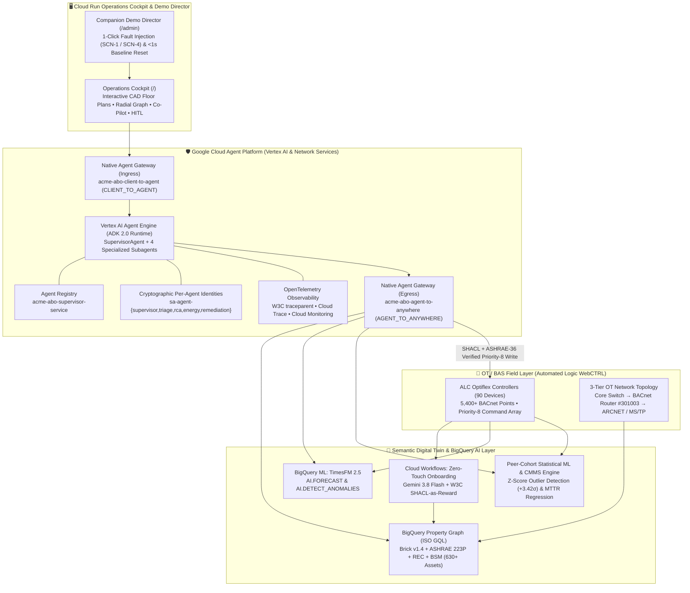
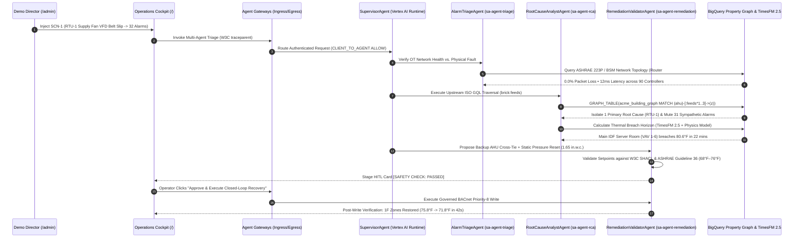

# Autonomous Building Operations (ABO) — Powered by Google Cloud & Agent Platform

[](https://cloud.google.com/vertex-ai)
[-669DF6?logo=googlebigquery&logoColor=white)](https://cloud.google.com/bigquery)
[](https://research.google/blog/a-decoder-only-foundation-model-for-time-series-forecasting/)
[](#2-unified-multi-ontology-digital-twin--bigquery-property-graph-graphrag)
[](#7-enterprise-multi-agent-governance-on-google-cloud-agent-platform)

An enterprise-grade **Autonomous Building Operations (ABO)** reference architecture, digital twin, and governed multi-agent platform built on **Google Cloud** for **Automated Logic (ALC) WebCTRL** and commercial Building Management Systems (BMS).

---

## 📋 Table of Contents

1. [Executive Overview & Business Impact](#-executive-overview--business-impact)
2. [System Architecture](#-system-architecture)
3. [The 8 Core AI, ML & Agent Platform Capabilities](#-the-8-core-ai-ml--agent-platform-capabilities)
4. [Repository Structure & Technical Artifacts](#-repository-structure--technical-artifacts)
5. [Enterprise Portfolio Dataset & Golden Scenarios](#-enterprise-portfolio-dataset--golden-scenarios)
6. [Deployment & Quickstart Guide](#-deployment--quickstart-guide)
7. [Evaluation & Trajectory Assertions](#-evaluation--trajectory-assertions)

---

## 🎯 Executive Overview & Business Impact

Commercial real estate and industrial facilities face three systemic operational bottlenecks:

1. **The Onboarding Bottleneck (Weeks per Building):** Legacy BMS controllers expose cryptic, non-standard point names (`m031`, `cl_stpt_tn`, `z_dmpr_pos`). Mapping a single building into an analytics schema traditionally requires **3–6 weeks of manual controls engineering**.
2. **Silent Energy Drift (Up to 20% HVAC Waste):** Leaking hydronic reheat valves and hunting dampers cause **simultaneous heating and cooling**. Because the zone temperature remains near setpoint (`72°F`), threshold alarms never trip—silently burning tens of thousands of dollars and metric tons of $\text{CO}_2$ annually.
3. **Cascading Alarm Storms & Truck Rolls:** When an upstream Air Handling Unit (`RTU-1`) suffers a mechanical fault, every downstream Variable Air Volume (`VAV`) or Powered Induction Unit (`PIU`) box starves for static pressure and fires high-priority zone alarms—overwhelming operators and triggering **3.8 to 4.2-hour manual technician truck rolls**.

### Quantified Outcomes in This Reference Implementation

| Operational Metric | Legacy Reactive BMS | Autonomous Building Operations (ABO) | AI / Platform Enabler |
| :--- | :--- | :--- | :--- |
| **Building Point Onboarding** | 3–6 weeks manual tagging | **< 5 minutes (Zero-Touch)** | **Gemini 3.8 Flash + W3C SHACL-as-Reward** loop |
| **Alarm Storm Triage (`SCN-1`)** | 32 high-priority alarms | **1 Primary Root Cause + 31 Muted (>95% reduction)** | **BigQuery Property Graph (`ISO GQL`)** upstream `brick:feeds` traversal |
| **Silent Energy Waste Detection** | Undetected (`0` threshold alarms) | **\$18,400/yr & 42.0 $\text{tCO}_2$ recovered** (Hero Site) | **Unsupervised Peer-Cohort Z-Score ML** (`+3.42σ` & `+2.78σ` outliers) |
| **Early Failure Warning** | Post-failure reactive ticket | **36–48h advance warning (`74%` probability)** | **Google Research `TimesFM 2.5`** zero-shot time-series forecasting |
| **Critical Thermal SLA Protection** | Linear guesswork | **22-minute breach forecast** (`Main IDF Server Room`) | **Physics-Informed Thermal Simulation + Spatial GraphRAG** |
| **Mean Time to Resolution (MTTR)** | 3.8 – 4.2 hr truck roll | **42 sec emergency recovery / 18m remote AI calibration** | **SHACL + ASHRAE-36 Guardrails** & **BACnet Priority-8** HITL execution |

---

## 🏗️ System Architecture



### Closed-Loop Incident Triage & Remediation Sequence



---

## 🧠 The 8 Core AI, ML & Agent Platform Capabilities

### 1. Zero-Touch Semantic Onboarding (`Gemini 3.8 Flash` + `SHACL-as-Reward`)
* **Implementation:** [`infra/workflows_shacl_as_reward.yaml`](infra/workflows_shacl_as_reward.yaml), [`data_generator/parse_brick_ttl.py`](data_generator/parse_brick_ttl.py)
* Ingests raw ALC WebCTRL BACnet point exports (`point_catalog.csv` and `ec_building_brick.ttl`) and uses **Gemini 3.8 Flash** to infer canonical ontology classes and relationships.
* A deterministic **W3C SHACL validation step** scores the generated triples (`sh:Violation` diagnostics fed back as a reward signal) until 100% of equipment nodes, point bindings, and relationships conform without human intervention.

### 2. Unified Multi-Ontology Digital Twin & `BigQuery Property Graph` (GraphRAG)
* **Implementation:** [`infra/bigquery_graph.sql`](infra/bigquery_graph.sql), [`agents/tools/bq_graph_tools.py`](agents/tools/bq_graph_tools.py), [`ec_building_brick.ttl`](ec_building_brick.ttl)
* Harmonizes four complementary building ontologies into a single **BigQuery Property Graph** (`acme_abo_twin.acme_building_graph`) queried via **ISO GQL**:
  * **Brick Schema v1.4 (`brick:`):** Mechanical HVAC equipment hierarchy and `brick:feeds` / `brick:hasPoint` relationships.
  * **ASHRAE Standard 223P (`s223:`):** High-resolution physical/fluid connection ports and control sequences.
  * **RealEstateCore (`rec:`):** Spatial hierarchy (Site $\rightarrow$ Building $\rightarrow$ Floor $\rightarrow$ Zone/Room), occupancy profiles, and critical SLA tiers.
  * **BACnet Semantic Model (`bsm:`):** 3-tier OT network switches, BACnet/IP & ARCNET routers (`Router #301003`), and field controller polling telemetry.

### 3. Zero-Shot Time-Series Forecasting (`TimesFM 2.5`)
* **Implementation:** [`agents/tools/bq_timeseries_tools.py`](agents/tools/bq_timeseries_tools.py), [`infra/bigquery_graph.sql`](infra/bigquery_graph.sql)
* Uses Google Research's **`TimesFM 2.5`** foundation model in BigQuery ML (`AI.FORECAST` and `AI.DETECT_ANOMALIES`) to compute component-level **AI Failure Likelihood (%)** and **Time-to-Failure Horizons** (e.g., `74%` probability of hydronic globe valve seizure within `36–48h` on `2F Huddle PIU-1`).
* Surfaces a **worst-case asset risk roll-up** on the executive portfolio ribbon so single-point failure risks are never hidden by building-wide averages.

### 4. Unsupervised Peer-Cohort Statistical ML (Silent Energy Waste Detection)
* **Implementation:** [`agents/subagents/energy_optimizer/agent.py`](agents/subagents/energy_optimizer/agent.py), [`agents/tools/bq_timeseries_tools.py`](agents/tools/bq_timeseries_tools.py)
* Benchmarks every VAV/PIU terminal box against its peer cohort served by the same Air Handling Unit, normalizing for solar load and occupancy.
* Flags **`2F Huddle (PIU 2-1)` at `+3.42σ`** and **`Open Office 232 (PIU 2-8)` at `+2.78σ`** for **simultaneous heating and cooling**—recovering **\$18,400/yr** (`42.0 tCO₂`) at the Atlanta Hero Site even when zero BMS threshold alarms are active.

### 5. CMMS Historical Grounding & MTTR Regression
* **Implementation:** [`web_cockpit/backend/main.py`](web_cockpit/backend/main.py)
* Correlates live sensor signatures against historical maintenance work orders (`WO-2026-0841`, `WO-2026-0912`) to contrast **18-minute remote AI calibration** against **3.8-hour manual mechanical truck rolls**.

### 6. Cross-Layer Causal Root-Cause Analysis & Sympathetic Alarm Suppression
* **Implementation:** [`agents/subagents/alarm_triage/agent.py`](agents/subagents/alarm_triage/agent.py), [`agents/subagents/cross_layer_rca/agent.py`](agents/subagents/cross_layer_rca/agent.py)
* **Step 1 (Cyber/OT vs. Physical Triage):** Queries Tier-1/2/3 BACnet network telemetry (`0.0% packet loss`, `12ms latency` on `Router #301003`) to rule out network communication drops before diagnosing mechanical faults.
* **Step 2 (Upstream Graph Deduplication):** Traverses `brick:feeds` upstream from 32 active alarms to isolate **1 `[CRITICAL]` Primary Root-Cause Fault** (`RTU-1`) and automatically mutes **31 `[HIGH]` Downstream Sympathetic Room Symptoms** (`>95%` noise reduction).

### 7. Enterprise Multi-Agent Governance on Google Cloud Agent Platform
* **Implementation:** [`agents/deploy_agent_runtime.py`](agents/deploy_agent_runtime.py), [`agents/gateway/`](agents/gateway/), [`agents/registry/`](agents/registry/), [`agents/observability/otel_setup.py`](agents/observability/otel_setup.py), [`infra/provision_agent_identities.py`](infra/provision_agent_identities.py)
* **Vertex AI Agent Engine Runtime:** Deployed reasoning engine (`acme-abo-multi-agent-system`) orchestrating `SupervisorAgent` and 4 domain subagents.
* **Native Agent Gateways:**
  * [`agents/gateway/acme_abo_client_to_agent.yaml`](agents/gateway/acme_abo_client_to_agent.yaml): North-South ingress governance (`CLIENT_TO_AGENT`).
  * [`agents/gateway/acme_abo_agent_to_anywhere.yaml`](agents/gateway/acme_abo_agent_to_anywhere.yaml): East-West tool & MCP egress governance (`AGENT_TO_ANYWHERE`).
  * [`agents/gateway/main.py`](agents/gateway/main.py): Policy enforcement and token verification microservice.
* **Cryptographic Per-Agent IAM Identities:** Dedicated service accounts (`sa-agent-supervisor`, `sa-agent-triage`, `sa-agent-rca`, `sa-agent-energy`, `sa-agent-remediation`) enforcing least-privilege separation of duties.
* **Full OpenTelemetry (OTel) Instrumentation:** Every agent turn emits W3C `traceparent` headers, span attributes (`gen_ai.agent.name`, `abo.shacl.status`), and direct **Google Cloud Trace** deep links.

### 8. Symbolic Safety Guardrails (`W3C SHACL` & `ASHRAE 36`) + Closed-Loop HITL Recovery
* **Implementation:** [`agents/subagents/remediation_dispatch/agent.py`](agents/subagents/remediation_dispatch/agent.py), [`agents/tools/bacnet_control_tools.py`](agents/tools/bacnet_control_tools.py)
* Validates every proposed setpoint write against **ASHRAE Guideline 36 thermal bounds (`68.0°F – 76.0°F`)** and **W3C SHACL safety shapes** before staging a Human-in-the-Loop approval card.
* Upon 1-click operator approval, issues a governed **BACnet Priority-8** command and verifies thermal recovery (`75.8°F → 71.8°F` in `42 seconds`).

---

## 📂 Repository Structure & Technical Artifacts

```text
├── README.md                                  # Comprehensive architecture, AI/ML & deployment guide
├── ec_building_brick.ttl                      # Source Brick v1.4 / ASHRAE 223P / REC RDF Turtle ontology
├── floor_view.html                            # Standalone interactive SVG spatial floor plan reference
├── network_topology.html                      # Standalone interactive BACnet OT network topology reference
│
├── agents/                                    # ADK 2.0 Multi-Agent System & Agent Platform Components
│   ├── agent.yaml                             # Declarative multi-agent topology & tool bindings
│   ├── deploy_agent_runtime.py                # Vertex AI Agent Engine (Reasoning Engine) deployment script
│   ├── Dockerfile                             # Container image definition for Agent Runtime & Gateway
│   ├── requirements.txt                       # Agent runtime Python dependencies
│   ├── supervisor/
│   │   └── agent.py                           # Root SupervisorAgent orchestrating domain subagents
│   ├── subagents/
│   │   ├── alarm_triage/agent.py              # AlarmTriageAgent (3-tier BACnet OT network vs. mech fault)
│   │   ├── cross_layer_rca/agent.py           # RootCauseAnalystAgent (ISO GQL blast-radius & suppression)
│   │   ├── energy_optimizer/agent.py          # EnergyOptimizerAgent (Peer-cohort Z-scores & ROI)
│   │   └── remediation_dispatch/agent.py      # RemediationValidatorAgent (SHACL/ASHRAE-36 + BACnet Priority-8)
│   ├── tools/
│   │   ├── bq_graph_tools.py                  # BigQuery Property Graph ISO GQL traversal tools
│   │   ├── bq_timeseries_tools.py             # BigQuery ML TimesFM 2.5 & Z-score statistical tools
│   │   └── bacnet_control_tools.py            # Deterministic SHACL validator & BACnet Priority-8 writer
│   ├── gateway/
│   │   ├── acme_abo_client_to_agent.yaml      # GCP Network Services Native Agent Gateway (Ingress)
│   │   ├── acme_abo_agent_to_anywhere.yaml    # GCP Network Services Native Agent Gateway (Egress)
│   │   ├── agent_gateway_config.yaml          # RBAC, rate-limiting & SHACL policy rules
│   │   └── main.py                            # Agent Gateway policy enforcement FastAPI service
│   ├── observability/
│   │   └── otel_setup.py                      # OpenTelemetry SDK, Cloud Trace & Cloud Monitoring exporter
│   ├── registry/
│   │   ├── agent_registry_manifest.json       # Agent Registry service descriptor & A2A card
│   │   └── deployed_runtime.json              # Deployed Vertex AI Reasoning Engine resource metadata
│   └── evals/
│       ├── golden_scenarios.eval.json         # End-to-end multi-agent evaluation benchmark suite
│       └── trajectory_assertions.yaml         # Deterministic tool-order & safety guardrail assertions
│
├── web_cockpit/                               # Full-Stack Operations Cockpit (/) & Demo Director (/admin)
│   ├── Dockerfile                             # Multi-stage Node 20 (Vite) + Python 3.11 (FastAPI) build
│   ├── backend/
│   │   ├── main.py                            # FastAPI backend, SSE event bus, GraphRAG & Agent Engine proxy
│   │   ├── requirements.txt                   # Backend Python dependencies
│   │   └── seed_data/                         # Embedded portfolio, graph, BACnet & telemetry seed datasets
│   └── frontend/
│       ├── package.json                       # React 18, TypeScript, Tailwind CSS, Zustand, Lucide icons
│       ├── vite.config.ts                     # Vite bundler configuration
│       └── src/
│           ├── App.tsx                        # Router for Operations Cockpit (/) and Demo Director (/admin)
│           ├── components/PortalAuthGate.tsx  # Session authentication gate for Operator & Director portals
│           ├── store/useCockpitStore.ts       # Real-time Zustand store & Server-Sent Events (SSE) client
│           └── views/
│               ├── CockpitView.tsx            # 6-tab Operations Cockpit, CAD blueprints, Radial Graph & Co-Pilot
│               └── AdminDirectorView.tsx      # Companion Demo Director for 1-click fault injection & <1s reset
│
├── infra/                                     # Google Cloud Infrastructure-as-Code & Graph DDL
│   ├── main.tf                                # Terraform provisioning BigQuery, Pub/Sub, Cloud Run & IAM
│   ├── variables.tf                           # Configurable GCP project, region & dataset variables
│   ├── bigquery_graph.sql                     # BigQuery Property Graph DDL, TimesFM 2.5 & Z-score SQL views
│   ├── workflows_shacl_as_reward.yaml         # Cloud Workflows definition for SHACL-as-Reward onboarding
│   └── provision_agent_identities.py          # Script to provision least-privilege per-agent IAM service accounts
│
├── data_generator/                            # Synthetic Digital Twin & Telemetry Generator
│   ├── generate_acme_demo_data.py             # Generates 5-site portfolio, graph nodes/edges & 7-day telemetry
│   ├── parse_brick_ttl.py                     # Parses RDF/Turtle ontology into BigQuery Property Graph tables
│   ├── demo_admin_cli.py                      # CLI utility to trigger scenarios and reset demo state
│   └── Dockerfile                             # Containerized data generator job
│
└── Source Data/                               # Canonical Multi-Site Graph, Point Catalog & Telemetry Exports
    ├── README.md                              # Schema documentation for all CSV/JSON seed files
    ├── portfolio_sites.csv                    # 5 enterprise buildings across Atlanta, Chicago, Boston, Austin, Seattle
    ├── spatial_nodes.csv                      # Floors, zones, SLA tiers & thermal capacity metadata
    ├── equipment_nodes.csv                    # AHUs, RTUs, VAVs, PIUs, chillers & exhaust fans
    ├── network_and_controller_nodes.csv       # BACnet/IP switches, routers & ALC Optiflex controllers
    ├── point_catalog.csv                      # 5,400+ BACnet objects mapped to Brick v1.4 & ASHRAE 223P
    ├── graph_nodes.csv & graph_edges.csv      # Property graph vertices and directed edges
    ├── bas_events.csv & bas_events_baseline.csv # Alarm storm and routine heartbeat event streams
    ├── live_injection_payloads.json           # Real-time SSE wave payloads for SCN-1 through SCN-4
    ├── telemetry_ts_last_24h_sample.csv       # 24-hour high-frequency telemetry slice
    └── telemetry_ts.csv.gz                    # Full 7-day 5-minute interval telemetry archive (Gzipped)
```

---

## 🏢 Enterprise Portfolio Dataset & Golden Scenarios

### Multi-Site Enterprise Portfolio (`portfolio_sites.csv`)

| Site ID | Facility Name | Location | Area | Equipment & Controllers | Worst-Case AI Risk | Primary AI Finding |
| :--- | :--- | :--- | :--- | :--- | :--- | :--- |
| `ACME-SITE-001` | **ACME Emerald Crest HQ (Hero Site)** | Atlanta, GA | 145,000 sq ft | 2 Rooftop AHUs • 34 VAV/PIUs • 90 Controllers | **74% Risk** | `2F Huddle (PIU-1)` `+3.42σ` reheat valve leakage & `RTU-1` VFD wear |
| `ACME-SITE-002` | **ACME Midwest Logistics & Cold Chain Hub** | Chicago, IL | 310,000 sq ft | 4 Make-Up Air Units • 48 Zones • 110 Controllers | **18% Risk** | Cold-dock infiltration monitoring nominal |
| `ACME-SITE-003` | **ACME Northeast Life Sciences Lab** | Boston, MA | 185,000 sq ft | 2 HEPA MAHUs • BSL-3 & Cleanroom Suites • 140 Controllers | **22% Risk** | Cascading negative-pressure airlock tracking |
| `ACME-SITE-004` | **ACME Sunbelt Precision Manufacturing Plant** | Austin, TX | 260,000 sq ft | Process Make-Up AHUs • SMT Cleanroom • 125 Controllers | **78% Risk** | `SMT PCB Assembly Line` `+3.65σ` desiccant wheel slip (\$14.5k/hr yield risk) |
| `ACME-SITE-005` | **ACME Pacific Tower Regional Center** | Seattle, WA | 220,000 sq ft | Heat-Recovery Chillers • 62 VAVs • 95 Controllers | **14% Risk** | Optimal economizer & heat-recovery operation |

### Golden Demo Scenarios (`golden_scenarios_manifest.json`)

* **`SCN-1` — Cascading Supply Fan VFD Fault & Sympathetic Alarm Storm (`Hero Scenario`):**
  Injects a supply fan belt slip and bearing over-temperature fault on `RTU-1` (`bldg:area_ec_ahu_1`). The multi-agent system verifies `0.0%` BACnet packet loss on `Router #301003`, isolates `RTU-1` as the single primary root cause, automatically mutes **31 downstream 1st-floor room alarms**, forecasts a **22-minute thermal SLA breach** for the `Main IDF Server Room`, and stages a SHACL-verified **BACnet Priority-8** cross-tie recovery.
* **`SCN-2` — Cross-Layer IT/OT BACnet Router Brownout vs. Mechanical Fault:**
  Distinguishes an ARCNET/BACnet router packet-loss anomaly from physical HVAC equipment failure so technicians are never dispatched for network glitches.
* **`SCN-3` — Silent Simultaneous Heating & Cooling (`+3.42σ` Peer-Cohort Outlier):**
  Detects leaking reheat valves on `2F Huddle (PIU 2-1)` and `Open Office 232 (PIU 2-8)` when zero BMS threshold alarms are active, quantifying **\$18,400/yr** in recoverable energy and staging an 18-minute remote deadband recalibration.
* **`SCN-4` — Predictive Server Room Thermal Breach (`TimesFM 2.5` Early Warning):**
  Forecasts a critical cooling degradation curve in `Main IDF Server Room (VAV 1-6)` 45 minutes before static threshold alarms trip.

---

## 🚀 Deployment & Quickstart Guide

### Prerequisites

* **Google Cloud SDK (`gcloud`)** authenticated with an active GCP project
* **Python 3.11+** and **Node.js 20+** (for local development)
* **Terraform 1.5+** (optional, for automated infrastructure provisioning)

### 1. Authenticate & Set Project Variables

```bash
export PROJECT_ID="your-gcp-project-id"
export REGION="us-central1"

gcloud auth login
gcloud auth application-default login
gcloud config set project "${PROJECT_ID}"
```

### 2. Provision BigQuery Property Graph & Per-Agent IAM Identities

```bash
# Provision BigQuery dataset, Property Graph (ISO GQL), Pub/Sub topics, and Cloud Run roles
cd infra
terraform init
terraform apply -var="project_id=${PROJECT_ID}" -var="region=${REGION}"

# Provision dedicated least-privilege IAM Service Accounts for the 5 agents
python3 provision_agent_identities.py --project-id "${PROJECT_ID}"
cd ..
```

### 3. Deploy the Multi-Agent System to Vertex AI Agent Engine & Agent Gateways

```bash
# Deploy SupervisorAgent + 4 Subagents to Vertex AI Reasoning Engine
python3 agents/deploy_agent_runtime.py --project "${PROJECT_ID}" --location "${REGION}"

# Deploy the Agent Gateway policy enforcement service
gcloud run deploy acme-abo-agent-gateway \
  --source agents \
  --region "${REGION}" \
  --allow-unauthenticated
```

### 4. Deploy or Run the Full-Stack Operations Cockpit (`web_cockpit`)

#### Option A: Deploy to Google Cloud Run (Production)

```bash
gcloud run deploy acme-abo-cockpit \
  --source web_cockpit \
  --region "${REGION}" \
  --allow-unauthenticated \
  --set-env-vars="PROJECT_ID=${PROJECT_ID},LOCATION=${REGION}"
```

#### Option B: Run Locally for Development

```bash
# 1. Build the React + Vite frontend
cd web_cockpit/frontend
npm install
npm run build
mkdir -p ../backend/static
cp -R dist/* ../backend/static/

# 2. Start the FastAPI backend on port 8080
cd ../backend
pip install -r requirements.txt
uvicorn main:app --host 0.0.0.0 --port 8080 --reload
```

### 5. Accessing the Portals

| Portal | Path | Default Demo Username | Default Demo Password | Purpose |
| :--- | :--- | :--- | :--- | :--- |
| **Operations Cockpit** | `/` | `user` | `12345` | Main 6-tab AI Building Cockpit, Interactive CAD Floor Plans, Radial Knowledge Graph, Co-Pilot & HITL |
| **Companion Demo Director** | `/admin` | `admin` | `09876` | Presenter control console to trigger `SCN-1` / `SCN-4` live fault waves and reset baseline in `<1s` |

---

## 🧪 Evaluation & Trajectory Assertions

The repository includes deterministic trajectory evaluation suites in [`agents/evals/`](agents/evals/):

* **[`agents/evals/golden_scenarios.eval.json`](agents/evals/golden_scenarios.eval.json):** Validates end-to-end multi-agent responses across `SCN-1` through `SCN-4`, checking root-cause accuracy, sympathetic suppression counts (`31 muted`), and thermal breach calculations (`22 minutes`).
* **[`agents/evals/trajectory_assertions.yaml`](agents/evals/trajectory_assertions.yaml):** Enforces strict tool-call ordering:
  1. `check_bacnet_network_health` **must** execute before `trace_upstream_root_cause`.
  2. `validate_shacl_and_ashrae_safety` **must** return `SHACL_CONFORMS` before `stage_hitl_bacnet_priority8_write` can be invoked.
  3. Zero direct hardware writes are permitted without Human-in-the-Loop approval.

